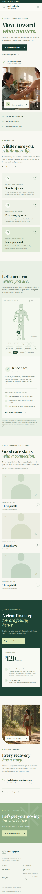

# Motion Physio

A warm, responsive website concept for a physical therapy clinic focused on sports injuries and post-surgery rehabilitation. The app combines a 12-region interactive body map, a visitor FAQ assistant, appointment requests, and a clinic-managed internal scheduling calendar.

> **Project status:** This repository contains the website source and documentation. A public website/demo has not been deployed. The included screenshots are static previews; see the [demo guide](docs/DEMO.md) for the interactive local walkthrough and current data/authentication prerequisites.

## Preview




## What is included

- Responsive clinic landing page with a clear first-visit price of **$120**.
- Interactive body map with 12 selectable regions and general, region-specific care-plan information.
- Three therapist profile placeholders. Names, individual biographies, and credentials have not been supplied.
- Pricing and insurance information. The first-visit price is shown; insurance participation and follow-up pricing are not confirmed.
- Recovery-story area marked as coming soon rather than presenting invented testimonials.
- A scripted FAQ assistant for common questions. It is informational only, not medical advice, and does not assess emergencies.
- Appointment requests and a Motion Physio internal calendar. The calendar is not connected to Google Calendar, Outlook, or another external calendar provider.
- Staff calendar tools for publishing and managing availability, protected by sign-in and an email/admin authorization check.

## Demo

- **Static visual preview:** the screenshots above and [Demo walkthrough](docs/DEMO.md).
- **Interactive demo:** run the app locally using the instructions below. Database-backed booking and staff-calendar functions require a configured MySQL database and valid authentication/environment settings.
- **Live hosted demo:** not currently published. Publishing the website requires a separate hosting decision and authorization; connecting this code to GitHub alone does not deploy it.

The development database currently has no published appointment slots. Visitors can still explore the booking dialog and submit a preferred-time request, but such a request is **not a confirmed appointment**. Staff calendar access also requires an authorized account; see [Internal calendar notes](docs/CALENDAR.md).

## Tech stack

- React 19, TypeScript, Vite, and Tailwind CSS
- Express and tRPC
- Drizzle ORM with MySQL
- Vitest for automated tests
- pnpm 10.18.0 (declared in `package.json`)

## Run locally

### Prerequisites

- Node.js 22 recommended
- pnpm 10.18.0
- A dedicated MySQL database for development (do not point local tests at production data)
- Valid environment settings for the database and, when using sign-in, the configured OAuth/authentication provider

### Setup

```bash
git clone <repository-url>
cd motionphysio
corepack enable
corepack prepare pnpm@10.18.0 --activate
pnpm install --frozen-lockfile
cp .env.example .env
```

Edit `.env` with values for your **own** environment. At minimum, set `DATABASE_URL` to your development MySQL connection string before applying migrations. Authentication and platform API values must come from the relevant provider/deployment; the example file intentionally contains no usable secrets. Set `MOTION_CALENDAR_ADMIN_EMAIL` to the email address of the staff account that should manage the calendar. Keep `.env` private and never commit real credentials.

Apply the checked-in migrations, then start the development server:

```bash
pnpm db:migrate
pnpm dev
```

Open `http://localhost:3000`. The app expects the server to provide the configured runtime environment. The root page can be explored as a UI demo; live booking and staff management need the database and authentication configuration described above.

### Useful commands

```bash
pnpm check       # TypeScript check
pnpm test        # Automated tests
pnpm build       # Production build
pnpm start       # Run the production build
pnpm db:migrate  # Apply checked-in migrations to DATABASE_URL
```

`pnpm db:push` is intended for schema development and generates migration files; review generated changes before applying them.

## Project map

```text
client/                 React application and UI components
  src/components/       Body map, booking modal, FAQ assistant, shared UI
  src/pages/            Home page and protected staff calendar page
server/                 Express/tRPC services and application logic
  calendar.ts            Internal availability, reservation, and staff actions
  booking.ts             Appointment request handling
  db.ts                  MySQL/Drizzle connection
  _core/                 Runtime, OAuth, and server infrastructure
drizzle/                 Schema and checked-in SQL migrations
docs/                    English demo and calendar documentation
```

## Privacy and content notes

- Appointment and calendar records are stored in the configured MySQL database. Use a dedicated development database and follow applicable privacy/security requirements before handling real patient information.
- Do not collect or include medical history in demo requests. The public form asks for contact details, a service, and a preferred time.
- Names, credentials, clinic address/hours, insurance participation, follow-up pricing, and genuine recovery stories have not been provided and should be verified before replacing placeholders or making public claims.
- Body-map content is general educational copy, not diagnosis or medical advice. Post-surgery care should be guided by the patient's clinical team.

## Documentation

- [Interactive demo walkthrough](docs/DEMO.md)
- [Internal appointment calendar](docs/CALENDAR.md)
- [Environment variable template](.env.example)
