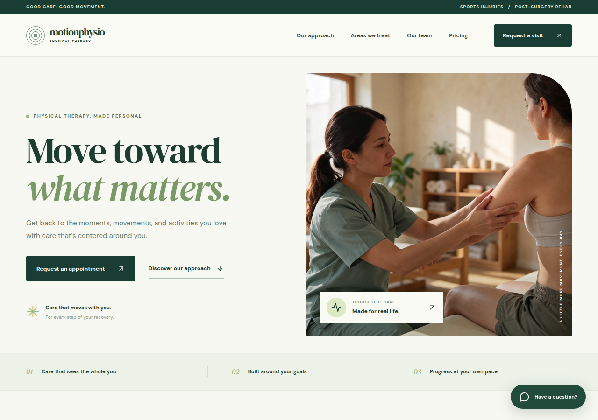
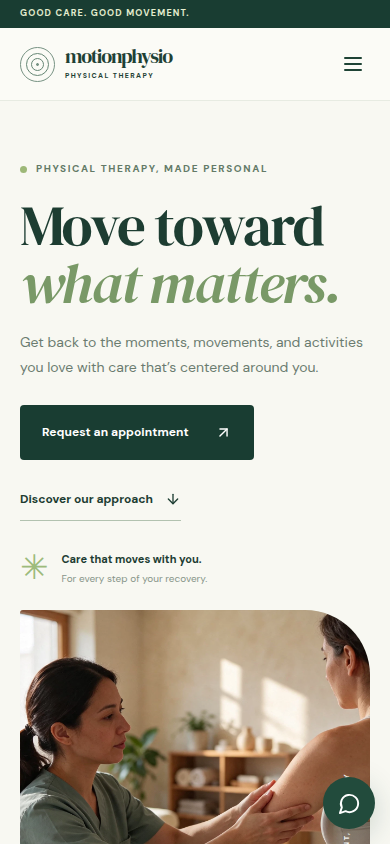
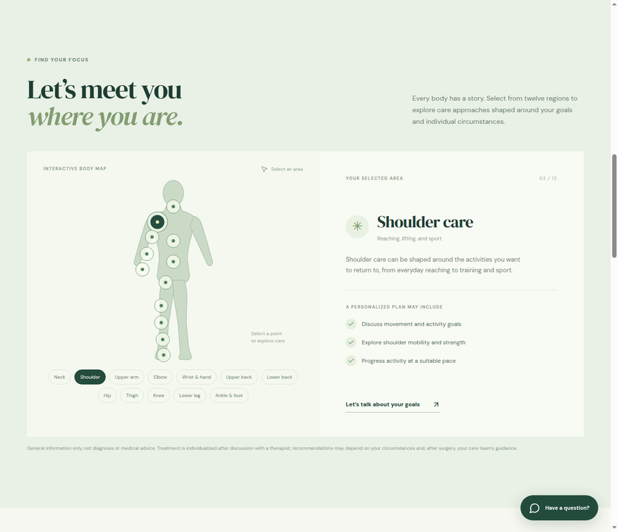
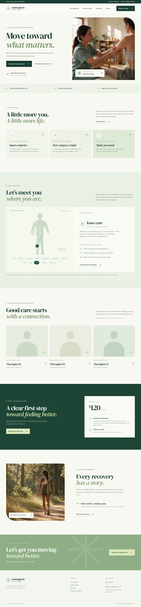

# Motion Physio

**A full-stack physical therapy website and appointment-scheduling portfolio project.** Motion Physio combines a warm, responsive visitor experience with a clinic-managed calendar designed around real availability, time zones, and staff-reviewed appointment requests.

[](https://github.com/Anahita19/motion-physio)

> **Demo status:** The repository includes the application source, local setup instructions, and static screenshots. The website is not currently hosted as a live demo. Screenshots are visual captures—not a recording or interactive preview. Run the project locally to explore its interactions.

## Product overview

The project presents a concept website for a physical therapy clinic focused on sports injuries and post-surgery rehabilitation. Visitors can explore care information and request an appointment; authorized staff can manage availability and review appointment requests in an internal calendar.

### Visual tour

**Desktop experience**



<details>
<summary>View the mobile experience</summary>



</details>

**Interactive body-map example — Shoulder selected**



The shoulder image is a static screenshot of an actual interactive selection. It illustrates the interface state; it is not an animation or hosted demo.

<details>
<summary>View full-page desktop and mobile captures</summary>




</details>

For the walkthrough and demo boundaries, see [docs/DEMO.md](docs/DEMO.md).

## Product features

### Visitor experience

- Responsive landing page with a clear **$120 first-visit price** and appointment-request entry points.
- Interactive, accessible body map covering **12 regions**; selecting a hotspot or region button updates the associated general information and possible plan elements.
- Therapist profile cards presented as placeholders—not verified people or credentials.
- Pricing and insurance content that avoids claiming unverified coverage.
- Recovery-story section marked as coming soon rather than populated with invented testimonials.
- Scripted FAQ assistant for common questions; it is not generative AI, medical advice, or emergency support.
- Appointment flow for selecting a published opening or requesting a different preferred time.

### Staff and scheduling

- Protected staff calendar at `/staff/calendar` for managing availability and appointment requests.
- Authorized staff can publish or edit open slots, confirm pending requests, and cancel reserved or confirmed appointments.
- Public availability exposes only open slots; a visitor's reservation is **pending** until staff confirmation.
- Each slot stores its date, local start time, IANA time zone, therapist placeholder, duration, and status. The product does not assume clinic-wide hours or a default time zone.

## Engineering highlights

- **Transactional reservation flow:** the server locks and rechecks a selected slot inside a database transaction before creating a pending request. Stale or already-reserved slots return a conflict instead of being silently double-booked.
- **Time-zone-aware scheduling:** server logic validates IANA zone identifiers, converts local slot times into instants, rejects nonexistent local times, and checks overlapping durations across time zones for the same therapist.
- **Explicit state transitions:** availability, reservation, confirmation, and cancellation are distinct states, with staff actions guarded by the current state.
- **Validated API boundaries:** tRPC procedures apply Zod input schemas and server-side authorization before database operations; dates, times, durations, and appointment fields are checked on the server.
- **Protected staff access:** calendar mutations require authentication plus either an admin role or a match to the configured staff email.
- **Layered full-stack structure:** React UI, Express/tRPC procedures, Drizzle data access, MySQL schema, and checked-in SQL migrations have separate responsibilities.
- **Automated checks:** the repository provides TypeScript checking, Vitest tests, and a production build command (`pnpm check`, `pnpm test`, and `pnpm build`).

## Technology

| Layer | Technologies and role |
| --- | --- |
| UI | React 19, TypeScript, Vite, Tailwind CSS 4, and Lucide icons for the responsive application and interactive components. |
| Forms and API state | React Hook Form and Zod for form/input validation; tRPC React and TanStack Query for typed API calls and server-state handling. |
| Application server | Node.js, Express, and tRPC for HTTP serving and typed procedures shared with the client. |
| Persistence | MySQL with Drizzle ORM, explicit schema definitions, and checked-in SQL migrations. |
| Quality and delivery | TypeScript 5.9, Vitest, esbuild, and pnpm 10.18.0. |

## Run locally

### Requirements

- Node.js 22 recommended
- pnpm 10.18.0 (pinned by the project)
- MySQL for database-backed availability, booking, and staff-calendar features
- Valid authentication-provider settings for sign-in and staff-calendar access

### 1. Clone and install

```bash
git clone https://github.com/Anahita19/motion-physio.git
cd motion-physio
corepack enable
corepack prepare pnpm@10.18.0 --activate
pnpm install --frozen-lockfile
```

### 2. Configure your local environment

Create a local environment file from the safe template:

```bash
cp .env.example .env
```

Use a **dedicated development database** and edit `.env` with your own values. For a locally running MySQL instance, `DATABASE_URL` follows the form below (create the database and user first, and URL-encode special characters in credentials):

```dotenv
DATABASE_URL=mysql://<username>:<password>@127.0.0.1:3306/<database>
```

The template lists all supported variables. These are used for the corresponding capabilities:

| Variable | Purpose |
| --- | --- |
| `DATABASE_URL` | MySQL connection for availability, reservations, appointment requests, and migrations. |
| `MANUS_PROJECT_ID` | Application identifier used by the configured Manus OAuth integration. |
| `MANUS_OAUTH_API_URL` | OAuth service endpoint used during sign-in. |
| `MANUS_JWT_SECRET` | Server-side signing secret for application sessions. |
| `MOTION_CALENDAR_ADMIN_EMAIL` | Optional staff email allowed to manage the calendar; the account must also sign in. An authenticated admin role is an alternative. |
| `MANUS_API_URL`, `MANUS_API_KEY` | Server-side credentials for Manus platform APIs used by platform-backed features. Keep these private. |

OAuth and API values must come from an environment you control and are authorized to use; this repository does not include credentials. Never commit `.env` or real keys. `.env.example` contains blank placeholders only.

> **UI-only exploration:** The public homepage can be explored without seeding calendar data. Database-backed availability and booking require a reachable MySQL database. Sign-in and staff-calendar operations additionally require valid OAuth configuration and staff authorization.

### 3. Apply database migrations

Start MySQL and ensure `DATABASE_URL` points to your **development** database, then run:

```bash
pnpm db:migrate
```

This applies the checked-in schema migrations to the selected database. Do not point local development or tests at production or shared clinic data. No appointment slots are seeded automatically.

### 4. Start the app

```bash
pnpm dev
```

Open [http://localhost:3000](http://localhost:3000). The Express server hosts the Vite development experience and API. With a configured database, visitors can see slots published by staff; because no demo slots are seeded, the initial calendar is empty. A visitor may request another time, but that is a request—not a confirmed appointment.

For the staff workflow, configure OAuth and `MOTION_CALENDAR_ADMIN_EMAIL` (or an authenticated admin role), then visit `http://localhost:3000/staff/calendar` and publish test availability in your development database.

## Verification commands

```bash
pnpm check       # TypeScript type-check
pnpm test        # Unit and integration tests
pnpm build       # Build the client and server
pnpm start       # Serve the production build
```

The database commands are:

```bash
pnpm db:migrate  # Apply checked-in SQL migrations
pnpm db:push     # Generate and apply schema changes during development
```

Review generated migration changes before using `pnpm db:push`; do not run schema-changing commands against a production database without an explicit backup and review.

## Architecture at a glance

```text
Visitor / Staff
      │
      ▼
React + TypeScript UI
      │ typed tRPC calls
      ▼
Express application server
      │ Drizzle ORM
      ▼
MySQL
```

```text
client/                  React application and shared UI
  src/components/        Body map, booking modal, FAQ assistant
  src/pages/              Home page and staff calendar
server/                  Express/tRPC application logic
  calendar.ts             Availability, reservations, and staff operations
  booking.ts              Appointment request handling
drizzle/                  Database schema and SQL migrations
docs/                     Demo walkthrough and calendar guide
```

## Scope and responsible-use notes

This is a **portfolio/demo project**, not a clinic-ready deployment. No real therapist names or credentials, clinic address or hours, insurance participation, follow-up prices, or patient recovery testimonials have been provided. Verify those facts before replacing placeholders or making public clinic claims.

The body-map copy is general information, not diagnosis or medical advice. The FAQ assistant is scripted and does not assess emergencies. The internal calendar has no external calendar sync, clinic-wide hours, default time zone, or seeded open slots; staff defines availability per slot. Do not enter real patient data into a demo environment.

## Further documentation

- [Demo walkthrough and screenshot guide](docs/DEMO.md)
- [Internal appointment calendar](docs/CALENDAR.md)
- [Environment variable template](.env.example)
- [Public GitHub repository](https://github.com/Anahita19/motion-physio)
