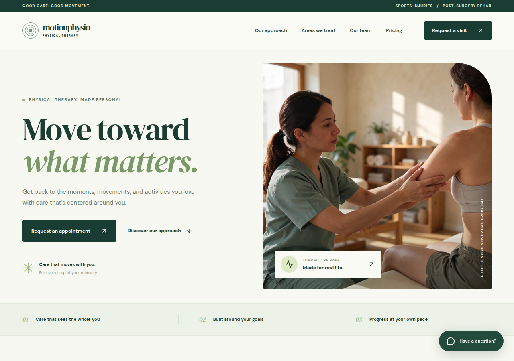
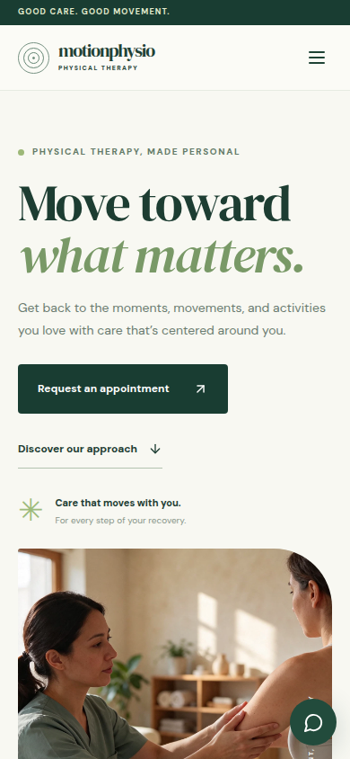
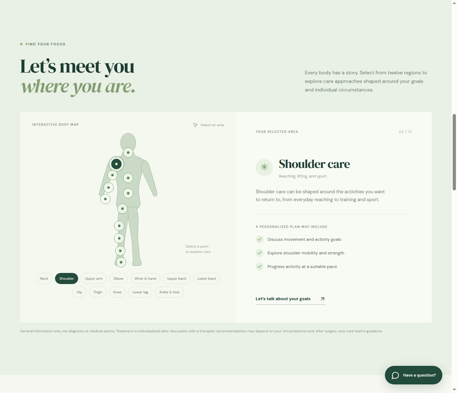
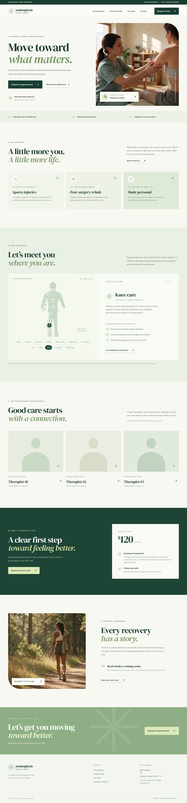
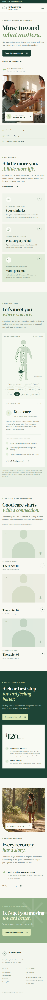

# Motion Physio Demo Guide

This guide documents the current application. The images below are static screenshots captured from the local project preview. They are not a hosted demo, a screen recording, or a substitute for the interactive application. To try the interactions, run the project locally using the root [README](../README.md).

## Visual tour

### Desktop hero

### Mobile hero

### Interactive body map: Shoulder selected

This body-map image is a static capture of an actual selection made in the running interface. The project itself has interactive hotspots and region buttons; choosing a region updates the care-information panel. The screenshot does not replay that interaction.

View full-page desktop and mobile screenshots

## Visitor walkthrough

1. **Explore the homepage.** The hero presents Motion Physio as a clinic concept focused on sports injuries and post-surgery rehabilitation. Use the main navigation or page links to move through the sections.
2. **Explore the body map.** Go to “Let’s meet you where you are.” Select one of 12 regions—neck, shoulder, upper arm, elbow, wrist & hand, upper back, lower back, hip, thigh, knee, lower leg, or ankle & foot. The panel updates with general focus areas and possible plan elements. These are informational examples, not a clinical assessment.
3. **Review the team and pricing.** The page displays three therapist placeholders and the stated **$120 first-visit price**. Individual identities and credentials are not represented as verified facts. Insurance participation and follow-up pricing remain unconfirmed.
4. **Review recovery stories.** The section is marked as “Real stories, coming soon”; no patient testimonials are fabricated.
5. **Try the FAQ assistant.** Open “Have a question?” and try the suggested questions about price, insurance, or appointment requests. Its answers are scripted; it is not a generative AI or medical service. Urgent concerns should be directed to appropriate medical care.
6. **Open appointment requests.** Use “Request an appointment.” The calendar source is Motion Physio’s internal calendar. At the current demo data state there are no published open slots, so try “Request another time” to inspect the preferred-date/time form. Submitting a preferred time is a request only, not a confirmed booking.

## Staff calendar walkthrough

The staff interface is available at `/staff/calendar`. To use it, the signed-in account must have the `admin` role or its email must exactly match the configured `MOTION_CALENDAR_ADMIN_EMAIL` value (comparison is case-insensitive). A valid authentication setup and database are required. See [Internal appointment calendar](CALENDAR.md) for the staff workflow and safeguards.

The demo does not contain pre-seeded availability. Once an authorized staff member adds an open slot, it appears in the public booking calendar. A visitor can reserve that slot; the reservation remains pending until staff confirms it.

## Run the interactive demo locally

Follow the prerequisites, environment setup, migrations, and `pnpm dev` instructions in the root [README](../README.md). Without a configured MySQL database, public availability and booking mutations cannot be demonstrated. Without working authentication and staff authorization, the protected staff operations are unavailable.

## Demo boundaries

- No live public URL is included; the project has not been deployed as part of this documentation update.
- Screenshots are static captures of selected application states. They do not demonstrate click-through behavior, and there is no recording or GIF.
- Hero and page imagery are illustrative design assets, not verified photographs or representations of a particular clinic or therapist.
- The calendar is internal to Motion Physio and has no external calendar sync.
- The calendar time zone and opening hours are entered as part of each staff-created slot; no clinic-wide hours or default time zone are assumed.
- A slot reservation is not a confirmed appointment. The clinic must confirm it in the staff calendar.
- The page is a software demo, not a source of diagnosis or individualized medical advice.
